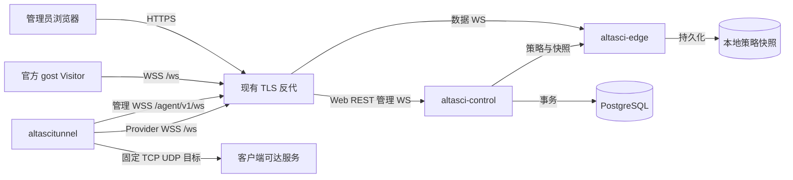
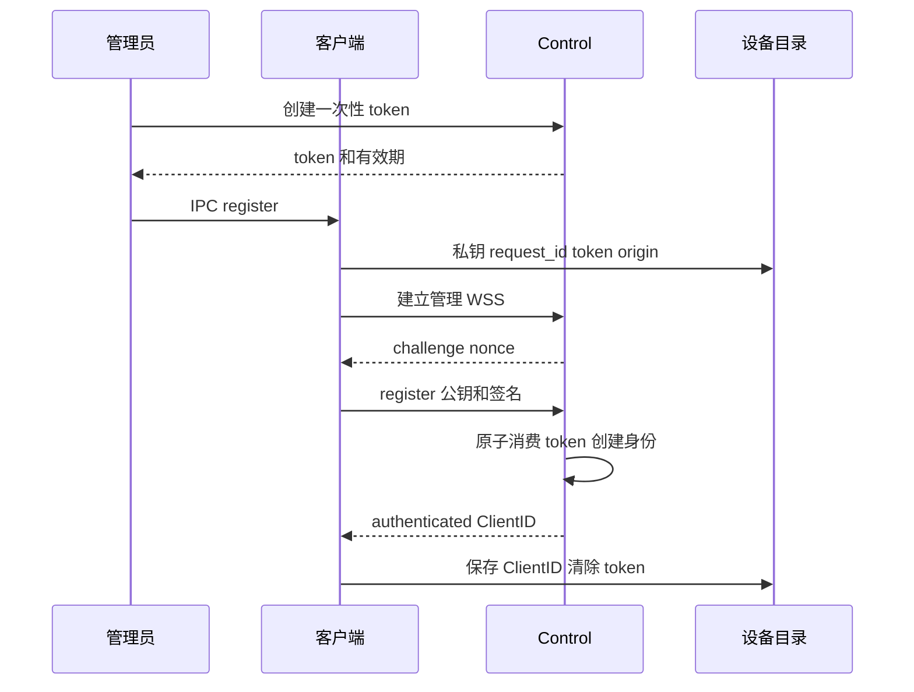
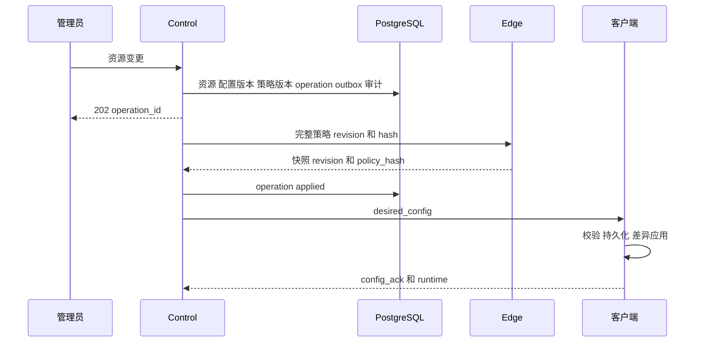

# 系统架构

## 组件与连接

Control 与 Edge 是同一 Linux 主机上的两个进程，数据库可以使用既有远端服务。反代产品自行选择，满足 [网络契约](configuration.md#反代与网络契约) 即可。客户端把管理模块与 GOST Runtime 放在一个进程中；Visitor 使用官方 gost，不申请设备身份。

跨网握手由设备或 Visitor 主动发起，随后业务双向传输。服务端不主动拨号设备的公网入站端口。

## 平面划分

| 平面 | 接口 | 职责 |
| --- | --- | --- |
| 管理 | HTTPS `/api/v1/*` | 登录、资源、凭据、审计和操作查询 |
| 设备控制 | WSS `/agent/v1/ws` | 挑战认证、配置、ACK、心跳和状态 |
| 数据 | WSS `/ws` | GOST Provider Bind、Visitor Connect 和业务流量 |
| 内部协调 | Unix socket 或本机 TCP | 策略应用、快照、指标和健康 |

内部监听只允许字面量 loopback 或 Unix socket。应用不提供直接的对外 TLS listener；TLS 由反代终止。本机 TCP 管理接口依赖本机进程信任，Unix socket 可进一步限制操作系统用户/组。

## 注册时序

成功响应丢失时，同 request_id、公钥和新挑战签名能恢复原 ClientID。旧 token 无法代替原私钥。

## 配置变更时序

每秒协调数据库当前期望状态。API 提交、Edge 生效、设备应用分别有证据。确认不仅比较 revision，也比较策略 hash。离线设备收到最新快照，不依赖重放全部历史增量。

## 数据访问和撤销

Provider 凭据绑定设备、TunnelID、协议、generation，只允许 Bind。Visitor 凭据只允许 Connect 到其 TunnelID。GOST 处理多路复用；客户端 Router 强制使用平台目标，忽略 Visitor 传入目标。

Edge 跟踪原始连接，在策略变更后关闭失效授权对应连接，并在 Bind 入池、Connect 打开流等阶段重复校验，避免并发撤销逃逸。目标、协议、启用状态变化递增 generation、轮换 Provider 并关闭旧业务连接；纯名称修改可保留运行对象。

## 故障矩阵

| 故障 | 数据面 | 管理面与恢复 |
| --- | --- | --- |
| Control 停止 | Edge 继续最后有效策略，已有数据可继续 | 注册/变更暂停，Control 重启后重新协调 |
| PostgreSQL 故障 | 不逐请求查库，沿用已确认授权 | 数据库操作失败，恢复后协调重试 |
| 管理 WSS 断开 | Runtime 独立，已有数据连接保留 | 状态 stale，独立持久退避后重连 |
| Edge 停止 | 数据连接中断 | 重启加载有效快照，设备与 Visitor 重连 |
| Edge 无有效快照 | 拒绝未经确认的授权 | 等待 Control 同步策略后就绪 |
| 客户端停止 | 该设备反向连接中断 | 同状态目录重启保留身份并恢复配置 |
| 目标不可达 | Bind 仍可能 connected，业务访问失败 | 检查客户端到目标的真实连通性 |

Edge 独立执行凭据到期；Control/数据库停机期间，新的管理撤销无法传达到 Edge。缓存可用性不等于离线管理操作仍可实时生效。

## 扩展边界

当前围绕单 Control、单 Edge 和聚合事务实现。没有 leader election、跨 Edge 路由或自动故障切换。数据库写锁只保证事务串行化，不提供多控制实例管理会话协调。

千隧道模拟结果不能作为生产容量承诺。需要扩展时，先测真实网络、TLS 代理、数据库与进程资源，再评估 [架构决策](decisions.md) 中的约束。
