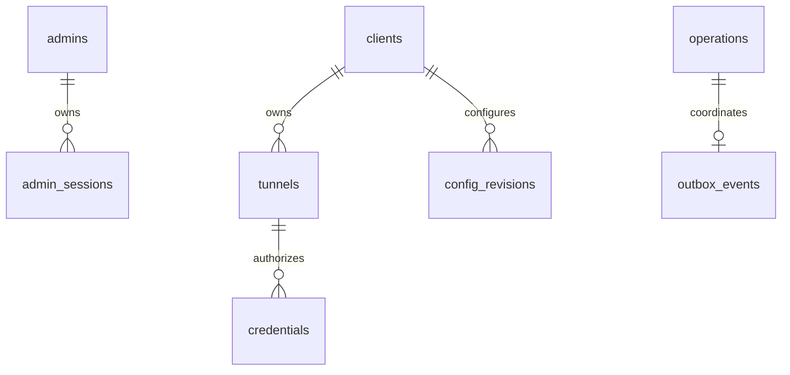

# 数据模型与一致性

## 存储形式

数据库迁移位于 `internal/store/migrations`，当前基线是 `00001_initial.sql`。资源按实体拆表，每表以 `id` 为主键，主体放在 JSONB `payload`。用于外键、唯一性、筛选和检查的字段由生成列提取。

图示只表示 SQL 中显式约束的主要关系。JSON 中存在关联 ID 不代表数据库为它建立了外键，例如 enrollment 的 ClientID 是应用级恢复关联。

## 表与用途

| 表 | 主体与关键约束 | 使用方式 |
| --- | --- | --- |
| `control_meta` | 唯一 `id=1`，全局 policy_revision | 策略版本基准 |
| `admins` | 用户名生成列唯一、密码 hash | 管理登录 |
| `admin_sessions` | admin_id 外键、到期时间、CSRF | Cookie token 的摘要索引 |
| `clients` | 公钥唯一、身份和配置确认版本 | 设备持久状态 |
| `enrollments` | token digest、到期/撤销、request_id 唯一 | 一次消费与响应丢失恢复 |
| `tunnels` | client_id 外键，protocol、IPv4、端口约束 | 隧道定义与软删除 |
| `credentials` | tunnel_id 外键，username 唯一 | Provider/Visitor 摘要与密文 |
| `config_revisions` | client_id 外键，设备+revision 唯一 | 加密完整配置快照 |
| `edge_policy_revisions` | 完整授权策略 | 当前及历史策略 |
| `operations` | 幂等 key 唯一、请求 hash、结果 | accepted/pending/applied |
| `outbox_events` | 主键同时引用 operations | 持久协调记录 |
| `audit_events` | actor、action、resource、时间 | 管理审计 |
| `runtime_snapshots` | 已有迁移表 | 当前不提供完整持久运行历史功能 |

隧道 client_id 与凭据 tunnel_id 具备索引。应用还校验具体 IPv4 单播语义，SQL 的 `family(target_ip)=4` 只提供基础地址族约束。

## 核心实体

设备保存 ClientID、公钥、OS/arch/version、撤销标志、revision、received_revision、applied_revision、LastSeen 和最近运行信息。设备私钥只在客户端目录，不入控制数据库。

隧道保存 ClientID、名称、协议、目标、enabled、deleted、generation、version 和创建时间。删除是逻辑删除，历史审计与凭据可继续关联原资源。目标端口 1–65535，协议为 tcp 或 udp。

凭据保存 kind、设备/隧道关联、username、digest、ciphertext、generation、可选 expires_at 和 revoked。Edge 策略仅收到 digest 等校验材料，永远不需要凭据密文。Provider 的 generation 用于阻止旧目标/配置继续 Bind；Visitor 仍绑定同一 TunnelID，但相关旧连接可以因策略变化关闭。

## 四类版本

| 字段 | 范围 | 推进条件 | 作用 |
| --- | --- | --- | --- |
| `Tunnel.version` | 单资源 | 资源编辑 | REST If-Match 并发控制 |
| `Tunnel.generation` | 单隧道数据授权 | 协议、目标或启用状态变化 | 淘汰旧 Provider 与旧数据连接 |
| `Client.revision` | 单设备配置 | 设备期望配置变化 | 完整配置排序和 ACK |
| `policy_revision` | 全局 Edge 策略 | 管理授权变更 | 策略协调与 operation 生效依据 |

资源 version、配置 revision 和 generation 不能互换。客户端 received/applied 不得超过自身期望 revision，applied 不得超过 received。

配置和策略均有 SHA-256 hash。配置 hash 根据定义的 Go 类型、字段顺序、空 hash 值和排序后的资源计算，不是任意 JSON 重新序列化后都能得到同值。跨语言实现必须建立编码兼容测试。

## 读写与原子性

读取使用 PostgreSQL Repeatable Read 只读事务，得到一致 State。常规读取只取每设备最新配置与 control_meta 指向的当前策略，避免每轮协调加载全部历史快照。

写事务取得 advisory lock `72634001`，读取当前聚合、执行修改、按差异 upsert/delete，并在同一事务提交派生快照、operation、outbox 和审计。冲突/失败回滚，不留下只改资源却没生成配置的半完成变更。

这是一种单控制实例下的明确一致性实现；聚合规模扩大时，读取、序列化和串行写入可能成为瓶颈。sqlc 当前提供数据库元信息查询，不应将所有动态实体操作描述为 sqlc CRUD。

## 幂等与 operation

管理请求的 Idempotency-Key 按管理员 ID 隔离，与方法、URL.Path 和原始请求体字节的摘要关联。相同 key 与相同请求返回原结果；同 key 不同内容返回 409。JSON 空格或字段顺序变化也会改变请求摘要，并不执行 JSON 语义规范化。成功提交后即使 HTTP 响应丢失，调用者可以重试而不重复创建资源。

operation 的 applied 表示所需 Edge 策略已确认，不表示设备已收到配置。outbox 不是独立消息代理；协调器读取持久状态并向 Edge/在线设备同步完整快照。

## 保留与清理

Control 启动时及其后约每小时执行 `Prune`：

| 数据 | 当前清理规则 |
| --- | --- |
| 管理会话 | 删除已到期项 |
| 审计 | 保留约 180 天 |
| 运行快照表 | 删除 updated_at 超过 7 天的记录 |
| 设备配置历史 | 超过 7 天且不是该设备最新版本时可删除 |
| Edge 策略历史 | 非当前策略，且关联操作超过 7 天时可删除 |
| 已 applied 的 outbox/operation | 超过 180 天时删除 |

没有声称所有撤销设备、凭据或过期 enrollment 会被自动物理清除。修改保留规则需同步审计和恢复要求。恢复旧库必须推进版本并更新授权，见 [恢复流程](operations.md#恢复旧数据库)。
