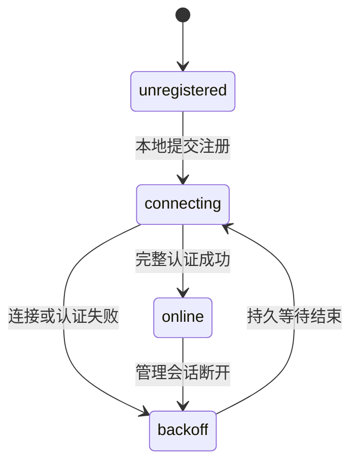

# 技术实现

## 代码地图

| 路径 | 责任 | 关键约束 |
| --- | --- | --- |
| `cmd/altasci-control` | CLI、迁移、密钥、管理员、恢复命令和 HTTP 启动 | 默认 loopback；容器业务入口显式放宽 |
| `cmd/altasci-edge` | 数据监听、内部管理入口和引擎启动 | 数据入口与内部管理入口分开 |
| `cmd/altasci-server` | 容器入口、双进程管理、初始化与健康检查 | 不代理业务，不包含数据库或客户端；子进程退出时停止整个容器 |
| `cmd/altascitunnel` | run/register/status、系统服务、内部安装动作 | CLI 管理通过 IPC，不创建第二个运行实例 |
| `internal/control` | REST、管理员认证、设备协议、配置/策略生成和 reconcile | 持久化先于返回 accepted |
| `internal/edge` | 授权、策略缓存、连接跟踪、快照和指标 | 只有当前有效策略允许数据请求 |
| `internal/agent` | Daemon、身份、IPC、Runtime、固定目标 Router | 管理和数据生命周期独立 |
| `internal/model` | 资源、配置、策略、摘要和目标校验 | 序列化也是协议约定 |
| `internal/store` | PostgreSQL 聚合仓储、迁移、保留策略 | 读快照、写事务与 advisory lock |
| `internal/secure` | Ed25519 之外的 token、密码 hash 和 AES vault | 不将高熵 token 当用户密码处理 |
| `internal/retry` | 可取消的精确退避和持久状态 | 5 倍数列，无最大次数 |
| `internal/localfile` | 临时文件、同步、原子替换 | 私钥/配置/重试写入使用共同路径 |
| `internal/host` | loopback 校验、Unix socket 与 HTTP 退出 | 不把内部端口开放到任意地址 |
| `web/src` | React 页面、API 客户端、类型和交互 | 状态语义与后端保持一致 |
| `third_party/gost-x` | 固定版本 GOST 实现与受控扩展 | 只维护补丁清单中的功能差异 |

## 控制端事务与协调

REST 写入通过仓储 `Update` 读取当前状态、校验资源及并发版本、修改资源并生成派生记录。事务内同时保存受影响设备配置版本、全局策略版本、加密配置快照、operation、outbox 与审计。

`Server.queue` 为每个受影响设备递增 revision，为每次策略变更递增全局 policy revision。`config` 根据当前设备和隧道生成完整 ClientConfig，`policy` 只输出当前启用且未撤销设备/隧道的授权；不把凭据密文传给 Edge。

`Server.Start` 启动协调与保留任务。协调约每秒执行一次：

1. 读取一致数据库快照，生成当前期望策略。
2. 已知 Edge revision/hash 不同时，调用内部接口 Apply 完整策略。
3. 再读 Edge 运行快照；revision 和 policy_hash 必须都匹配。
4. 将所需 policy revision 已被覆盖的待处理 operation/outbox 标记 applied。
5. 对健康管理会话投递最新完整配置；未确认配置约 30 秒后可重发。

发送队列有界，慢写或断开的管理会话会关闭并在重连后重新同步。协调失败保留持久期望状态，下一轮重试；不通过撤销数据库事务掩盖 Edge 临时不可达。

## 客户端 Daemon

Daemon 启动时先取得单实例锁，加载身份、已保存配置、管理重试状态，然后启动本地 IPC。未注册时等待本地 register；注册生成身份后开始管理 WSS 认证。

客户端首先将 request_id、私钥和待消费 token 写入本地，再连接服务端挑战。认证成功后保存 ClientID 并清除待注册 token。后续握手签名新的 nonce，ClientID 保持稳定。保存的 origin 会约束重启参数，不允许已注册身份被静默切换到另一个服务器。

收到 `desired_config` 时，Daemon 检查协议 schema、ClientID、revision、hash 与目标约束。旧版本忽略，同版本不同 hash 拒绝。有效配置持久化后交给 Runtime 应用，最后上报 ACK 和运行状态。

## 隧道 Runtime

Runtime 用 TunnelID 索引 job，每个 job 具有独立 context、GOST service、重试策略和字节计数。完整快照通过差异比较决定保留、删除或重建对象：

- 未修改的对象继续运行，避免每次配置变更重启所有隧道。
- 删除/停用对象取消 context 并关闭 listener/service。
- 目标、协议、generation、Provider 凭据变化会替换对象。
- 全部对象成功应用才推进 applied revision；网络未 Bind 成功是运行状态，不等于配置结构错误。

Provider 由 GOST chain、tunnel connector、WS/WSS dialer、rtcp/rudp listener 与 remote handler 组合。`bindRouter` 在真实 Bind 成功后清零重试并报告 connected；service 初始化或 Ready 不是连接成功证据。

`targetRouter` 忽略 Visitor 请求的拨号目标，固定为平台下发的 IPv4 和端口。WSS 默认补 443，WS 默认补 80，因为 GOST Router 需要完整 host:port，不能依赖 HTTP 客户端的隐式默认端口。

## 重试与状态

图中是管理连接状态；已有身份启动后直接进入连接/退避流程。每个隧道 job 另有独立 connecting/connected/backoff/error 等状态，不能把管理 online 映射为全部隧道 connected。

管理连接和每条隧道分别持久化 `count`、`next`。一次失败结束后，等待 5、25、125、625、3125、3125……秒；完整认证/Bind 成功才清零。取消可以立即终止等待，时钟回拨的等待被限制在策略上限内。

管理会话 15 秒心跳/快照，服务端约 45 秒标记 stale，60 秒关闭失联管理会话；客户端 45 秒无服务端消息触发重连。Edge 快照通过 epoch、sequence、连接 ID 和 generation 区分不同生命周期。进程重启会重新开始本进程的字节计数，不能把它作为持久计费账本。

## GOST 扩展边界

`go.mod` 通过 replace 使用本地 `x v0.16.0`，与 `core v0.6.1`、官方 Visitor `gost v3.3.0` 对齐。六个文件的差异记录在 [补丁清单](../patches/manifest.json)。

扩展覆盖：Tunnel handler 授权 Hook 和连接追踪；Bind 入池/Connect 打开流前复核；service 可注入精确重试；tunnel connector 的 Bind 整体 deadline 与 context 取消。没有修改线上 GOST Visitor 协议，也未引入 Wisper 应用依赖。

不要格式化整个上游目录。基线恢复、补丁生成与兼容验证见 [补丁维护](../patches/README.md)。

## 前端

当前使用 React 19、Ant Design 6、Pro Components 3、Umi Max 4。准确版本由 `web/package.json` 和 package-lock 固定。`web/.npmrc` 的 legacy-peer-deps 处理 Umi 插件的历史 peer 约束；overrides 固定 React/ReactDOM 与 Pro Components 组合。

`web/src/api.ts` 统一 same-origin Cookie、CSRF、错误处理、幂等 key 和 If-Match。页面区分 operation 的 Edge 生效、配置 revision 与隧道连接，不把 accepted 显示为业务成功。

`esbuildMinifyIIFE` 避免异步 chunk 压缩 helper 的全局名称冲突。控制端静态服务对前端路由回退 index.html；因此未知 GET 路径返回 HTML 不能作为 API 存在或健康的证据。

## 实现限制

仓储是实体 JSONB + 聚合事务，不是所有资源均由 sqlc 生成 CRUD。`runtime_snapshots` 表已经迁移创建，但当前主要运行状态来自管理连接/Edge 内存快照和设备记录，不能据表存在推断有完整运行历史库。具体存储与保留见 [数据模型](data-model.md)。
